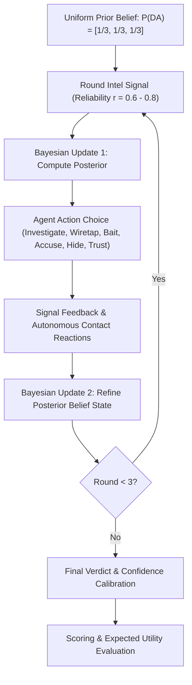

# 🕵️‍♂️ The Double Agent: Bayesian Game Theory Simulation

> **A real-time multiplayer espionage and asymmetric-information game rooted in Bayesian inference, signaling games, and strategic decision-making under uncertainty.**

[](https://nodejs.org/)
[](https://react.dev/)
[](https://vitejs.dev/)
[](https://socket.io/)
[](https://en.wikipedia.org/wiki/Bayesian_game)

---

## 📑 Table of Contents

- [Overview](#-overview)
- [Game Theory & Mathematical Foundation](#-game-theory--mathematical-foundation)
  - [1. Information Asymmetry & Hidden Types](#1-information-asymmetry--hidden-types)
  - [2. Dynamic Bayesian Updating](#2-dynamic-bayesian-updating)
  - [3. Strategic Signaling & Mixed Strategies](#3-strategic-signaling--mixed-strategies)
  - [4. Action Space & Resource Payoff Trade-offs](#4-action-space--resource-payoff-trade-offs)
  - [5. Expected Utility & Payoff Function](#5-expected-utility--payoff-function)
- [Game Flow & Protocol](#-game-flow--protocol)
- [Key Features](#-key-features)
- [Tech Stack & Architecture](#-tech-stack--architecture)
- [Project Structure](#-project-structure)
- [Getting Started](#-getting-started)
  - [Prerequisites](#prerequisites)
  - [Installation & Local Setup](#installation--local-setup)
  - [Multiplayer Over Local Network](#multiplayer-over-local-network)
- [License](#-license)

---

## 🌐 Overview

**The Double Agent** is a strategic social-deduction and probabilistic intelligence simulator for **1 to 4 agents**. 

Stationed at an intelligence bureau, players interact with three primary operatives: **Vega**, **Raven**, and **Cipher**. Unbeknownst to the Bureau, **one operative is a deep-cover Double Agent** funneling classified dispatches to foreign adversaries.

Over **3 operational rounds**, agents receive noisy field intelligence, deploy covert electronic gadgets, interrogate suspects, and update their beliefs. At the conclusion of Round 3, agents enter the **Final Verdict Phase** where they must expose the mole and calibrate their subjective confidence rating.

Every signal, reaction, and counter-move is governed by **probabilistic likelihood ratios and Bayesian updating**, creating an authentic simulation of decision-making under imperfect information.

---

## 📐 Game Theory & Mathematical Foundation

This project models counter-espionage as an **incomplete-information Bayesian game with dynamic signaling**.



### 1. Information Asymmetry & Hidden Types

- **Nature's Move**: At the start of an operation, Nature selects the true Double Agent $\theta^* \in \{\text{Vega}, \text{Raven}, \text{Cipher}\}$ from a discrete uniform distribution:
  $$P(\theta^* = c) = \frac{1}{3} \quad \forall c \in \{0, 1, 2\}$$
- **Incomplete Information**: The agents know the game structure and probability parameters, but the true state $\theta^*$ is hidden.
- **Asymmetric Payoffs**: Contact responses depend on whether they are innocent loyalists or the covert traitor exploiting vulnerabilities.

### 2. Dynamic Bayesian Updating

Each player maintains a subjective belief distribution $\mathbf{p} = [p_0, p_1, p_2]$ over the three suspects, where $\sum_{i=0}^2 p_i = 1$.

When an evidence event $E$ occurs regarding target $t$ with reliability factor $r \in (0.5, 1.0)$:
- If evidence is **incriminating** ($sus = \text{true}$):
  $$P(E \mid \theta = i) = \begin{cases} r & \text{if } i = t \\ 1 - r & \text{if } i \neq t \end{cases}$$
- If evidence is **exonerating** ($sus = \text{false}$):
  $$P(E \mid \theta = i) = \begin{cases} 1 - r & \text{if } i = t \\ r & \text{if } i \neq t \end{cases}$$

The belief vector updates in real time using **Bayes' Theorem**:
$$p_i' = \frac{P(E \mid \theta = i) \cdot p_i}{\sum_{j=0}^2 P(E \mid \theta = j) \cdot p_j}$$

The game tracks the full chronological history (trajectory trace) of posterior beliefs throughout all operational rounds.

### 3. Strategic Signaling & Mixed Strategies

Contacts do not act statically. When questioned or observed, they exhibit autonomous signaling behaviors:
1. **Accusatory Statement** ($a_0$): Blaming another contact.
2. **Defensive Silence** ($a_1$): Refusing to answer under interrogation.
3. **Agitated Probe** ($a_2$): Deflecting suspicion by questioning Bureau integrity.

#### Autonomous Reaction Distributions:
- **Innocent Operative Baseline**: Follows a standard behavioral distribution:
  $$\mathbf{POOL} = [0.72,\, 0.16,\, 0.12]$$
  Innocents name the true Double Agent with probability $q = 0.70$ (rising to $0.85$ if trusted).
- **Double Agent Exploitation Strategy**: The Double Agent blends between innocent mimicry and an exploitation strategy based on their current suspicion / alertness level $s \in [0.2, 0.9]$:
  $$\mathbf{P}_{\text{DA}} = s \cdot \mathbf{POOL} + (1 - s) \cdot \mathbf{EXPLOIT}$$
  $$\text{where } \mathbf{EXPLOIT} = [0.50,\, 0.10,\, 0.40]$$
  A cornered Double Agent exhibits a marked increase in agitation, silence, and false deflections toward innocent operatives.

### 4. Action Space & Resource Payoff Trade-offs

Agents possess finite operational resources ($3$ standard investigation tokens, integrity gauge at $100\%$, and single-use covert gadgets):

| Action | Resource Cost | Reliability ($r$) | Alert Impact | Strategic Trade-off |
| :--- | :---: | :---: | :---: | :--- |
| **Field Investigation** | 1 Token | $r = 0.80$ | $+0.20$ | Targeted inquiry; generates direct evidence but elevates subject suspicion. |
| **Covert Wiretap** | 1 Wiretap Gadget | $r = 0.85$ | $0.00$ | Undetected electronic audio intercept; zero alert penalty. |
| **Marked Disinformation Bait** | 1 Bait Gadget | $r = 0.90$ | $0.00$ | Feeds marked naval convoy plans. Rewards integrity ($+10$) if target is DA; damages cover ($-5$) if innocent. |
| **Cryptanalysis (Decrypt)** | 1 Decrypt Gadget | $r = 0.88$ | $0.00$ | Deep mainframe cryptographic sweep of target workstation for foreign microdots. |
| **Direct Accusation** | Free | $r = 0.65$ | $+0.40$ | High-risk confrontation. Tests composure ($65\%$ calm if DA vs $35\%$ if innocent). Modifies integrity ($+5$ if DA, $-15$ if false). |
| **Go Dark (Hide)** | Gains $+1$ Token | $r = 0.60$ | $0.00$ | Restores operational bandwidth (max 4 tokens); gathers low-noise passive surveillance across all 3 contacts. |
| **Trust & Brief** | Free | Varies | $-0.15$ | Pacifies operative alert for cleaner subsequent intel. Runs $35\%$ risk of leak ($-15$ integrity) if target is the Double Agent. |

### 5. Expected Utility & Payoff Function

At the conclusion of Round 3, each agent submits a suspect verdict along with a subjective confidence percentage $C \in [34\%, 100\%]$.

The final scoring model implements an **asymmetric utility function** that rewards accuracy while heavily penalizing overconfidence on false convictions:

$$\text{Total Utility} = \max\Big(0,\, \text{Base Score} + \text{Integrity Bonus} + \text{Resource Bonus}\Big)$$

#### 1. Base Score Matrix:
$$\text{Base Score} = \begin{cases} 
+100 + \lfloor \frac{C}{2} \rfloor & \text{if correctly exposed } \theta^* \\
-\lfloor (C - 34) \times 0.68 \rfloor & \text{if incorrect accusation} \\
-20 & \text{if no verdict submitted}
\end{cases}$$

> *Example*: Correctly naming the traitor at $100\%$ confidence yields $+150$ base points. An incorrect conviction at $100\%$ confidence inflicts a severe $-45$ penalty!

#### 2. Auxiliary Utility Bonuses:
- **Integrity Bonus**:
  $$\text{Bonus}_{\text{integrity}} = \begin{cases} 
  \lfloor \frac{\max(0, \text{Integrity})}{2} \rfloor & \text{if verdict is correct} \\
  \lfloor \frac{\max(0, \text{Integrity})}{4} \rfloor & \text{if verdict is incorrect}
  \end{cases}$$
- **Resource Conservation**:
  $$\text{Bonus}_{\text{resource}} = 5 \times \text{Remaining Resource Tokens}$$

---

## 🕹️ Game Flow & Protocol

```
[ Lobby Phase ]
  └─ Host initiates operation -> Generates 4-letter room code (e.g., 'HXKQ')
  └─ Agents join (1 to 4 players) -> Unique callsigns & cryptographic avatar signatures

[ Round 1 to 3: Multi-Agent Operation Loop ]
  ├─ Phase A: ACT (75s Countdown)
  │    ├─ Receive classified intel dossier (Category, Grade A-C, Location, Time)
  │    ├─ Select tactical maneuver (Investigate, Wiretap, Bait, Decrypt, Accuse, Hide, Trust)
  │    └─ Lock in action before the timer expires
  │
  └─ Phase B: BRIEFING (40s Countdown)
       ├─ Server evaluates action outcomes & autonomous contact reactions
       ├─ Agents review their private forensic debrief & rival public movements
       ├─ Bayesian probability curves & suspect rankings dynamically update
       └─ Agents signal 'READY' to proceed

[ Round 4: FINAL VERDICT (90s Countdown) ]
  ├─ Review complete 3-round belief trajectory trace
  ├─ Name prime suspect: Vega, Raven, or Cipher
  └─ Calibrate confidence slider (34% to 100%)

[ DEBRIEFING & LEADERBOARD ]
  ├─ Bureau unmasks the true Double Agent
  ├─ Individual score breakdown (Base + Integrity + Resource efficiency)
  └─ Winner announced & operation archive logged
```

---

## ✨ Key Features

- **Authoritative Server Game Loop**: Real-time room state synchronization with strict turn-based deadlines and anti-tamper server resolution.
- **Dynamic Bayesian Belief Gauge**: Interactive real-time probability distribution meters showing mathematical posteriors for Vega, Raven, and Cipher.
- **Procedural Espionage Audio Engine**: Synthesized in real time using the browser's Web Audio API — mechanical teletype clicks, CRT hum, classified alert chimes, and sonar blips.
- **Tactical Retro CRT Terminal Aesthetics**: Bespoke green/amber phosphor styling, CRT scanlines, flicker effects, responsive layout, and SVG avatar generation.
- **Resilient Reconnection Engine**: Session tokens enable instant, lossless reconnection if network connectivity flickers during an active operation.
- **Rival Agent Intelligence**: Monitors rival agents' public maneuvers during briefings without leaking their private deductions.

---

## 🛠️ Tech Stack & Architecture

- **Frontend**: [React 18](https://react.dev/), [Vite 5](https://vitejs.dev/), Vanilla CSS Design System with custom CRT filters, HTML5 Web Audio API.
- **Backend**: [Node.js](https://nodejs.org/), [Express](https://expressjs.com/), [Socket.IO](https://socket.io/) (WebSockets).
- **Algorithms**: Bayesian probability inference, discrete Markov transition modeling, expected utility evaluation.

---

## 📁 Project Structure

```
game-theory-project/
├── .gitignore               # Ignored dependencies and build outputs
├── README.md                # Comprehensive documentation & game theory whitepaper
├── index.html               # Main HTML entry with CRT scanline overlays
├── package.json             # Project scripts and dependencies
├── vite.config.js           # Vite development server configuration
├── server/
│   ├── game.js              # Core game theory engine (Bayesian updates, scoring, signals)
│   └── index.js             # Authoritative Socket.IO server, room management, timers
└── src/
    ├── App.jsx              # Main React application & tactical terminal UI
    ├── Avatar.jsx           # SVG procedural agent avatar generator
    ├── audio.js             # Procedural Web Audio API sound synthesis
    ├── main.jsx             # React DOM root mounting
    └── styles.css           # Espionage CRT theme, responsive layout, glowing HUD
```

---

## 🚀 Getting Started

### Prerequisites

Ensure you have **Node.js** (version 18.0.0 or higher) and **npm** installed on your system:
```bash
node -v
npm -v
```

### Installation & Local Setup

1. **Clone the repository**:
   ```bash
   git clone https://github.com/NidhiThakur-24/Game-Theory-Project.git
   cd Game-Theory-Project
   ```

2. **Install dependencies**:
   ```bash
   npm install
   ```

3. **Start in Development Mode** (Hot-reloading frontend + watched backend):
   ```bash
   npm run dev
   ```
   - Client runs at: `http://localhost:5173`
   - Server runs at: `http://localhost:3001`

4. **Production Build & Run**:
   ```bash
   npm run build
   npm start
   ```
   Open `http://localhost:3001` in your browser.

---

### 📡 Multiplayer Over Local Network

To play with multiple players across different laptops or smartphones connected to the same Wi-Fi / Local Network:

1. Start the server on the host machine:
   ```bash
   npm start
   ```
2. Identify the host machine's Local IPv4 address:
   - **Windows**: Run `ipconfig` (look for `IPv4 Address`, e.g., `192.168.1.45`)
   - **Mac/Linux**: Run `ifconfig` or `ip a`
3. Have other players open their browser and navigate to:
   ```
   http://<HOST_IP>:3001
   # Example: http://192.168.1.45:3001
   ```
4. Create an operation, copy the 4-letter room code, and share it with your agents!

---

## 📄 License

This project is licensed under the MIT License — feel free to study, extend, and deploy it for research, educational, or recreational purposes.
